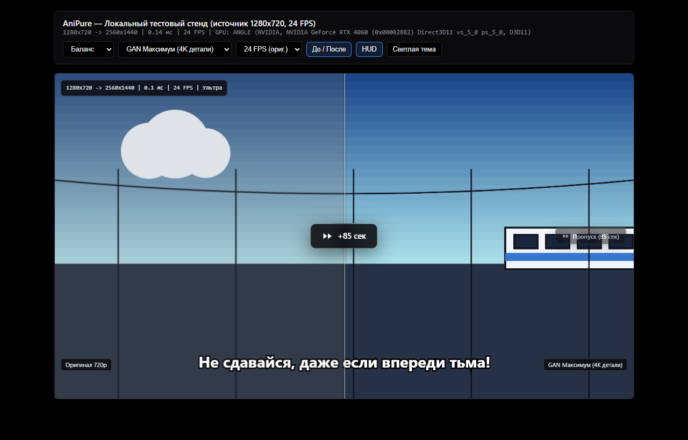
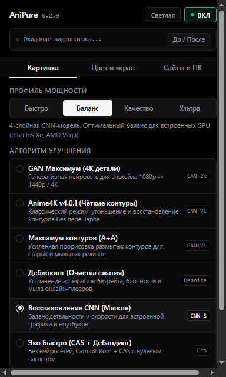

<p align="center">
  
</p>

<h1 align="center">AniPure</h1>

<p align="center">
  <strong>Real-time anime & video upscaler (720p &rarr; 1080p / 2K / 4K) powered by WebGL2 and Anime4K v4 neural networks.</strong>
</p>

<p align="center">
  <a href="https://github.com/nedarixxx/AniPure/releases"></a>
  <a href="LICENSE"></a>
  <a href="manifest.json"></a>
  <a href="src/engine/webgl-pipeline.js"></a>
  <a href="src/shaders/anime4k-models.js"></a>
</p>

<p align="center">
  <a href="README.md">English</a> | <a href="README.ru.md">Русский</a>
</p>

<p align="center">
  
</p>

---

## Highlights

- **Real-Time Neural Upscaling:** Transforms soft 720p anime streams into crisp 1080p, 1440p (2K), or 4K right inside the browser using official Anime4K v4 CNN/GAN models.
- **Hardware-Accelerated WebGL2:** Zero lag and minimal battery consumption. Runs multi-pass shaders with floating-point RGBA16F textures directly on your GPU.
- **Clean 4K/2K Frame Capture:** Capture pristine lossless PNG screenshots directly from the rendering buffer (`Alt+S`) without player overlays, subtitles, or watermarks.
- **Smart Opening & Ending Skip:** Dedicated 85-second skip button (`Alt+X`) with stealth auto-hide, safe duration boundary checks, and real-time OSD seek feedback.
- **Interactive Before / After Split Slider:** Drag-and-drop comparison slider on the player to inspect edge reconstruction, line thinning, and debanding in real time.
- **6 Cinematic Color Profiles:** Natural, Blu-ray, Vivid HDR, Night, Cinema Film, and True OLED Black, with Anti-Flash protection and vignette tuning.
- **Adaptive GPU Profiles:** Automatically benchmarks your hardware on first launch (from lightweight laptop iGPUs up to high-end NVIDIA GeForce RTX cards) and auto-throttles to prevent dropped frames.
- **100% Client-Side & Private:** Zero external API calls, zero telemetry, no tracking. Everything executes locally in your browser.

<p align="center">
  
</p>

---

## Architecture & Features

### 1. Neural Upscaling Pipeline
- Multi-pass execution of Anime4K v4 convolutional neural networks (Restore CNN, Upscale CNN x2, Upscale GAN x2, Upscale Denoise) on WebGL2 using RGBA16F floating-point textures.
- Intermediate texture pooling with tensor lifecycle management to minimize VRAM allocations and garbage collection overhead.
- Bitrate compression artifact suppression, deblocking, and contour edge restoration.

### 2. Adaptive Performance Profiles
- **Fast:** Single-pass Luma shader (Catmull-Rom bicubic interpolation + AMD FidelityFX Contrast Adaptive Sharpening in luminance space + debanding). Minimal GPU and CPU footprint, ideal for battery power on laptops.
- **Balanced:** Compact 4-layer CNN model designed for integrated GPUs (Intel Iris Xe, AMD Radeon Vega).
- **Quality:** Deep line reconstruction and upscaling for mid-tier discrete graphics (NVIDIA GeForce GTX 1660, RTX 3050).
- **Ultra:** Multi-pass generative model (Restore CNN Soft VL + Upscale GAN x2 M + Soft S) delivering 1440p/2160p output on high-performance GPUs (NVIDIA GeForce RTX 3060 / 4060 / 4070+).
- **Auto-Throttle:** Continuous frame render time monitoring with automatic profile step-down to prevent dropped frames.

### 3. Frame Interpolation (Optical Flow)
- GPU-accelerated motion vector estimation for increasing playback smoothness from 24 FPS to 48 or 60 FPS.
- Built-in Scene Cut Detection to disable blending during abrupt camera transitions, eliminating ghosting artifacts.

### 4. Color Grading and Post-Processing
- 6 fragment-shader color profiles:
  - **Natural:** Original stream colors without modification.
  - **Blu-ray:** Enhanced contrast and calibrated skin tone balance.
  - **Vivid HDR:** Expanded dynamic range and saturated colors.
  - **Night:** Warm spectrum with attenuated blue light.
  - **Cinema Film:** Cool shadows and soft warm highlights.
  - **OLED Deep:** True deep blacks without shadow detail clipping.
- **Anti-Flash:** Attenuates sudden harsh white flashes during intense action scenes.
- **Black Level Fix** and dynamic **Vibrance** adjustment.
- **Independent Vignette** control in the Fine-Tuning section.

### 5. Player Controls, Hotkeys & Clean Screenshots
- **Opening & Ending Skip:** Ergonomic button positioned vertically centered on the right edge ("Skip (85s)") to skip anime intros and credits instantly.
- **Stealth Auto-Hide:** Skip button appears when hovering over its right-center hotspot or directly interacting with it, and smoothly fades out after 1 second of inactivity.
- **Safe Boundary Seek:** Automatically prevents seeks from exceeding video duration, leaving safe headroom before the end of the episode.
- **Visual OSD Feedback:** Instant on-screen display badge (`+85s`) confirms seek completion directly over the video.
- **Customizable Skip Settings:** Toggle switch, range slider (30s–120s, default 85s), and customizable hotkey (default `Alt+X`) in the "Sites & GPU" settings tab.
- **Clean 4K/2K Screenshots:** Instant lossless PNG capture directly from the WebGL2 rendering buffer into your Downloads folder without watermarks or player overlays.
- **Customizable Hotkeys:** Flexible hotkey bindings with interactive recording and conflict prevention in settings.
- **Draggable Split-Screen Slider:** Inspect before/after results with a live draggable divider and side labels.
- **Domain & URL Whitelist Filtering:** Selective activation by domain, URL, or URL path.

### 6. Internationalization (i18n)
- Native bilingual support for English and Russian.
- Automatic locale detection: systems using `ru`, `be`, or `uk` receive the Russian interface; all other system languages default to English.
- Complete localization across all user touchpoints: extension popup, onboarding GPU benchmark, player overlays ("AniPure: ON/OFF"), split-screen labels, telemetry HUD, and system toast notifications.

---

## Installation

AniPure is compatible with Chromium-based browsers: **Google Chrome**, **Microsoft Edge**, **Brave**, **Opera**, and **Vivaldi**.

1. Download or clone this repository:
   ```bash
   git clone https://github.com/nedarixxx/AniPure.git
   ```
2. Open the extensions manager in your browser:
   - Google Chrome: `chrome://extensions/`
   - Microsoft Edge: `edge://extensions/`
   - Brave: `brave://extensions/`
3. Enable **Developer mode** via the toggle switch in the top-right corner.
4. Click **Load unpacked** (Загрузить распакованное расширение).
5. Select the project root folder (the directory containing `manifest.json`).
6. Upon installation, the hardware diagnostics page automatically opens to benchmark WebGL2 shader execution times on your GPU and recommend the optimal preset.

---

## Testing & Quality Assurance

### Unit Tests
Verifies Manifest V3 structure, GLSL ES 3.00 shader generation across all 14 Anime4K models, aspect ratio and dimension calculations, whitelist matching, i18n locale resolution, and benchmark classification:

```bash
node --test tests/core.test.js
```

### End-to-End Browser Tests
Launches a Chromium instance via Chrome DevTools Protocol (CDP), verifies WebGL2 initialization, validates popup layout in AMOLED and Light themes without clipping, runs real shader benchmark passes on the GPU, executes the 720p -> 1440p upscaling pipeline, and tests player overlay interactions and auto-hide timing:

```bash
node tests/webgl-e2e.js
```

### Local Test Bench
To verify enhancement offline without external streaming platforms, open `demo/test-player.html` in your browser with the extension installed. The page generates a synthetic 720p 24 FPS cel-shaded anime animation suitable for testing edge sharpness, frame interpolation, and split-screen comparison.

---

## Roadmap

- [ ] Firefox (Gecko / WebExtension) compatibility build
- [ ] User custom GLSL shader script injection
- [ ] Mouse gesture / custom mouse button hotkey bindings
- [ ] Experimental WebGPU compute pipeline
- [ ] Community preset sharing for popular streaming platforms

---

## Contributing

Contributions are what make the open source community such an amazing place to learn, inspire, and create. Any contributions you make are **greatly appreciated**!

If you have a suggestion that would make this better, please fork the repository and create a pull request. You can also simply open an issue with the tag "enhancement":

1. Fork the Project (`https://github.com/nedarixxx/AniPure/fork`)
2. Create your Feature Branch (`git checkout -b feature/AmazingFeature`)
3. Commit your Changes (`git commit -m 'Add some AmazingFeature'`)
4. Verify Tests Pass (`node --test tests/core.test.js`)
5. Push to the Branch (`git push origin feature/AmazingFeature`)
6. Open a Pull Request

Found a bug or want to request support for a specific anime player? [Open an issue on GitHub](https://github.com/nedarixxx/AniPure/issues)!

---

## Support the Project

If you enjoy using AniPure or find it useful for your anime watching, please consider giving it a star on GitHub! It helps more anime fans discover the project.

---

## Licenses & Acknowledgments

- **Anime4K:** Neural network architectures and weights developed by bloc97, licensed under the [MIT License](https://github.com/bloc97/Anime4K).
- **AMD FidelityFX CAS:** Contrast Adaptive Sharpening algorithm developed by AMD FidelityFX, licensed under the [MIT License](https://github.com/GPUOpen-LibrariesAndSDKs/FidelityFX-SDK).
- Full third-party license notices are documented in [THIRD_PARTY_NOTICES.md](THIRD_PARTY_NOTICES.md).
