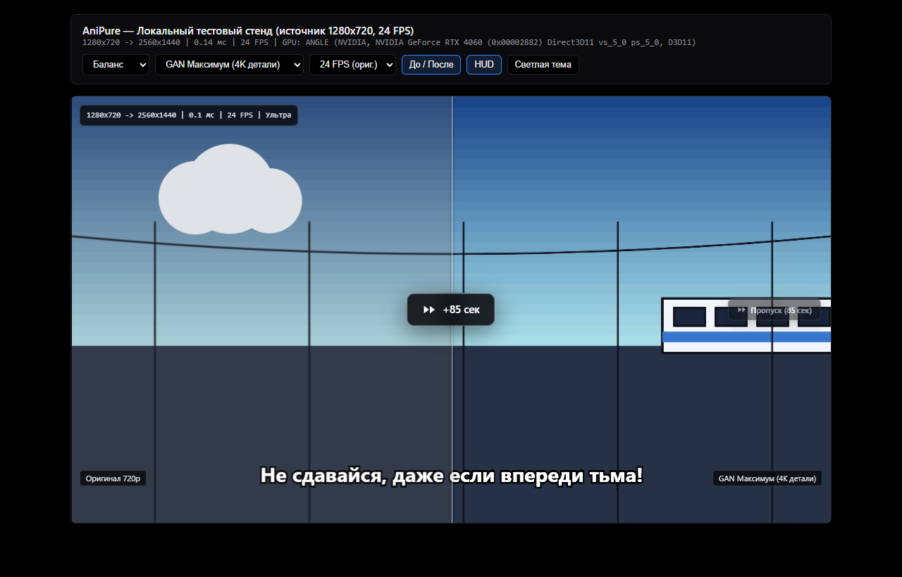
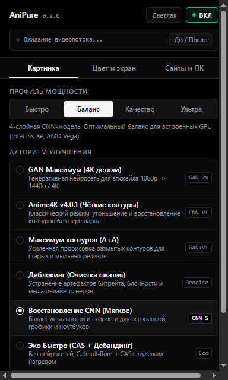

<p align="center">
  
</p>

<h1 align="center">AniPure</h1>

<p align="center">
  <strong>Масштабирование и улучшение аниме и видеопотока в реальном времени (720p &rarr; 1080p / 2K / 4K) на нейросетях Anime4K v4 и WebGL2.</strong>
</p>

<p align="center">
  <a href="https://github.com/nedarixxx/AniPure/releases"></a>
  <a href="LICENSE"></a>
  <a href="manifest.json"></a>
  <a href="src/engine/webgl-pipeline.js"></a>
  <a href="src/shaders/anime4k-models.js"></a>
</p>

<p align="center">
  <a href="README.md">English</a> | <a href="README.ru.md">Русский</a>
</p>

<p align="center">
  
</p>

---

## Ключевые возможности

- **Нейросетевой апскейл в реальном времени:** Превращает мыльное 720p аниме с веб-сайтов в кристально чёткое 1080p, 1440p (2K) или 4K прямо в браузере с помощью нейросетей Anime4K v4 (CNN / GAN).
- **Аппаратное ускорение WebGL2:** Отсутствие задержек и плавная картинка. Многопроходные шейдеры работают напрямую на видеокарте с использованием текстур повышенной точности RGBA16F.
- **Чистые скриншоты в 4K/2K:** Моментальный захват несжатых PNG-кадров без интерфейса плеера, субтитров и водяных знаков (`Alt+S`) прямо в папку «Загрузки».
- **Умный пропуск опенингов и эндингов:** Эргономичная кнопка «Пропуск (85 сек)» (`Alt+X`) с умным автоскрытием, безопасной границей конца серии и всплывающим OSD-индикатором.
- **Интерактивная шторка сравнения «До / После»:** Удобный ползунок прямо поверх видеоплеера, позволяющий наглядно оценить восстановление контуров и очистку от сжатия.
- **6 кинематографичных цветовых профилей:** Оригинал, Blu-ray, Сочный HDR, Ночной, Киноплёнка и True OLED Black с защитой от вспышек (Anti-Flash) и регулировкой виньетирования.
- **Адаптивные профили под любое железо:** Автоматический бенчмарк видеокарты при первой установке (от лёгкого режима для ноутбуков до максимума для карт NVIDIA GeForce RTX) и авто-троттлинг при риске пропуска кадров.
- **100% приватность и работа на клиенте:** Никаких внешних серверов, нулевая телеметрия. Всё вычисляется локально в вашем браузере.

<p align="center">
  
</p>

---

## Архитектура и возможности

### 1. Нейросетевой пайплайн масштабирования
- Реализация многопроходного инференса сверточных нейросетей Anime4K v4 (Restore CNN, Upscale CNN x2, Upscale GAN x2, Upscale Denoise) на WebGL2 в формате текстур RGBA16F.
- Пул промежуточных текстур с анализом жизненного цикла тензоров для минимизации выделения видеопамяти.
- Сглаживание артефактов компрессии битрейта, устранение блочности и восстановление четкости контуров.

### 2. Адаптивные профили производительности
- **Быстро (Fast):** Однопроходный Luma-шейдер (Catmull-Rom бикубическая интерполяция + AMD FidelityFX CAS в пространстве яркости + дебандинг). Минимальная нагрузка на встроенную графику и процессор, оптимально для ноутбуков при работе от аккумулятора.
- **Баланс (Balanced):** Легковесная 4-слойная CNN-модель для встроенных GPU (Intel Iris Xe, AMD Radeon Vega).
- **Качество (Quality):** Восстановление линий и масштабирование на дискретных GPU среднего уровня (RTX 3050, GTX 1660).
- **Ультра (Ultra):** Многопроходная генеративная модель (Restore CNN Soft VL + Upscale GAN x2 M + Soft S) с выводом в 1440p/2160p для видеокарт уровня NVIDIA GeForce RTX 3060 / 4060 / 4070+.
- **Auto-Throttle:** Автоматический контроль времени рендеринга кадра с понижением профиля при риске пропуска кадров.

### 3. Интерполяция кадров (Optical Flow)
- Расчет оптического потока на GPU для увеличения плавности с 24 FPS до 48 или 60 FPS.
- Встроенный детектор смены сцен (Scene Cut Detection) для предотвращения артефактов смазывания при склейках планов.

### 4. Цветокоррекция и постобработка
- 6 цветовых профилей на уровне фрагментного шейдера:
  - **Оригинал:** Исходные цвета без коррекции.
  - **Blu-ray:** Повышенный контраст, точная передача полутонов кожи.
  - **Сочный HDR:** Насыщенные цвета, расширенный динамический диапазон.
  - **Ночной:** Теплый спектр со сниженной интенсивностью синего света.
  - **Кинопленка:** Охлажденные тени и теплые света с пленочной фактурой.
  - **OLED Тёмный:** Глубокий истинный черный цвет без потери деталей в тенях.
- Функция мягкого света (**Anti-Flash**) для ограничения резких белых вспышек в экшен-сценах.
- Коррекция уровня черного (**Black Level Fix**) и динамическая сочность (**Vibrance**).
- Независимый регулятор виньетирования (**Vignette**) в блоке «Подстройка картинки».

### 5. Управление плеером, горячие клавиши и чистые скриншоты
- **Быстрый пропуск опенингов и эндингов:** Эргономичная кнопка по правому краю по центру («Пропуск (85 сек)») для мгновенного пропуска заставок и титров.
- **Умное автоисчезновение (Stealth Mode):** Кнопка пропуска появляется при наведении курсора на зону справа по центру или прямо на кнопку и плавно скрывается ровно через 1 секунду покоя мыши.
- **Безопасная перемотка:** Алгоритм автоматически рассчитывает границы видеопотока, исключая вылет за пределы длительности серии (`video.duration`).
- **Наглядный OSD-индикатор:** При нажатии на кнопку или горячую клавишу поверх видео отображается аккуратный индикатор `+85 сек`.
- **Тонкая настройка тайминга:** Тумблер включения, ползунок выбора длительности (от 30 до 120 сек, по умолчанию 85 сек) и настраиваемая горячая клавиша (по умолчанию `Alt+X`) в разделе «Сайты и ПК».
- **Чистые скриншоты в 4K/2K:** Моментальное сохранение кадра из WebGL2-буфера в папку «Загрузки» в формате PNG без интерфейса сайтов и водяных знаков (`Alt+S`).
- **Интерактивная запись хоткеев:** Возможность переназначить клавиши под себя прямо в окне настроек.
- **Шторка «До / После»:** Интерактивное разделение экрана для сравнения оригинального и улучшенного изображения.
- **Белый список сайтов:** Фильтрация по полному URL, домену или родительскому разделу.

### 6. Интернационализация (i18n)
- Поддержка двух языков интерфейса: английский (English) и русский (Русский).
- Автоматическое определение языка системы и браузера: при локалях `ru`, `be`, `uk` используется русский язык; для остальных — английский.
- Полная локализация всех компонентов: всплывающее окно, экран диагностики GPU, кнопки оверлея плеера («AniPure: ВКЛ/ВЫКЛ»), шторка сравнения, всплывающие уведомления и телеметрия.

---

## Установка в браузер

AniPure работает во всех браузерах на базе Chromium: **Google Chrome**, **Яндекс Браузер**, **Microsoft Edge**, **Brave**, **Opera**, **Vivaldi**.

1. Скачайте архив с кодом или клонируйте репозиторий:
   ```bash
   git clone https://github.com/nedarixxx/AniPure.git
   ```
2. Откройте страницу управления расширениями:
   - В Google Chrome: `chrome://extensions/`
   - В Яндекс Браузере: `browser://extensions/`
   - В Microsoft Edge: `edge://extensions/`
   - В Brave: `brave://extensions/`
3. Включите переключатель **Режим разработчика** (Developer mode) в правом верхнем углу страницы.
4. Нажмите кнопку **Загрузить распакованное расширение** (Load unpacked).
5. Выберите корневую папку проекта (папку, в которой находится файл `manifest.json`).
6. При первой установке автоматически откроется страница аппаратной диагностики, которая протестирует скорость шейдеров на вашей видеокарте и подберет лучший пресет.

---

## Тестирование и верификация

### Запуск модульных тестов
Проверяет корректность Manifest V3, компиляцию всех 14 моделей Anime4K в шейдеры GLSL ES 3.00, расчет разрешений, работу белого списка, логику автоопределения языка i18n и классификатор бенчмарка:

```bash
node --test tests/core.test.js
```

### Запуск сквозного браузерного E2E-теста
Запускает Chromium через Chrome DevTools Protocol (CDP), проверяет инициализацию WebGL2 контекста, корректность верстки попапа в AMOLED и светлой теме, проводит реальный бенчмарк шейдеров на GPU, запускает видеопоток 720p -> 1440p и проверяет интерактивные кнопки управления плеером:

```bash
node tests/webgl-e2e.js
```

### Локальный тестовый плеер
Для проверки работы без подключения к интернету откройте файл `demo/test-player.html` в браузере с установленным расширением. Страница генерирует синтетический 720p видеопоток 24 FPS и позволяет проверить четкость линий, интерполяцию и шторку сравнения.

---

## Планы по развитию (Roadmap)

- [ ] Версия для браузера Firefox (WebExtension / Gecko)
- [ ] Возможность загрузки пользовательских шейдеров GLSL
- [ ] Поддержка дополнительных кнопок мыши в горячих клавишах
- [ ] Экспериментальный движок на WebGPU
- [ ] Готовые пресеты настроек для популярных стриминговых сервисов

---

## Участие в разработке (Contributing)

Мы рады предложениям, новым идеям и пулреквестам!

Если вы хотите предложить улучшение или исправление:
1. Сделайте форк репозитория (`https://github.com/nedarixxx/AniPure/fork`)
2. Создайте свою ветку фичи (`git checkout -b feature/NewFeature`)
3. Зафиксируйте изменения (`git commit -m 'Добавлена новая возможность'`)
4. Проверьте тесты (`node --test tests/core.test.js`)
5. Отправьте ветку в свой репозиторий (`git push origin feature/NewFeature`)
6. Создайте Pull Request

Нашли ошибку или хотите добавить поддержку конкретного аниме-сайта/плеера? [Создайте Issue на GitHub](https://github.com/nedarixxx/AniPure/issues)!

---

## Поддержите проект

Если вам нравится смотреть аниме в повышенной четкости с помощью AniPure, поставьте звезду проекту на GitHub! Это помогает развивать проект и находить новых контрибьюторов.

---

## Лицензии и благодарности

- **Anime4K:** Архитектура и веса нейросетевых моделей разработаны bloc97, лицензия [MIT License](https://github.com/bloc97/Anime4K).
- **AMD FidelityFX CAS:** Алгоритм адаптивной резкости разработан AMD FidelityFX, лицензия [MIT License](https://github.com/GPUOpen-LibrariesAndSDKs/FidelityFX-SDK).
- Полные тексты лицензий сторонних компонентов приведены в файле [THIRD_PARTY_NOTICES.md](THIRD_PARTY_NOTICES.md).
